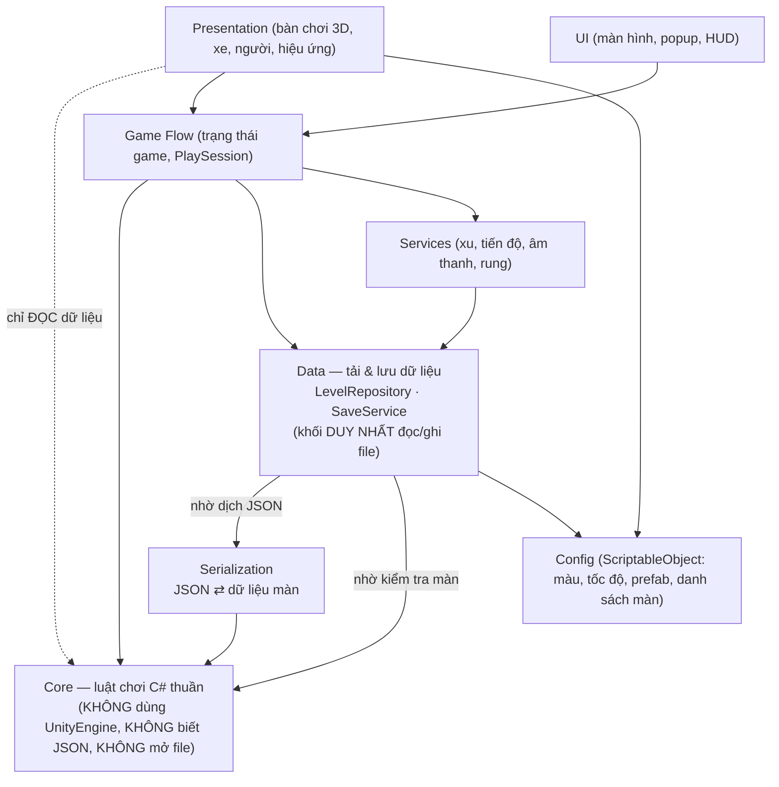
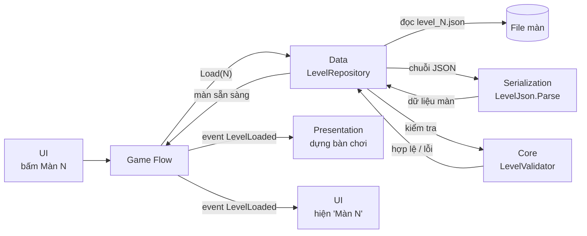
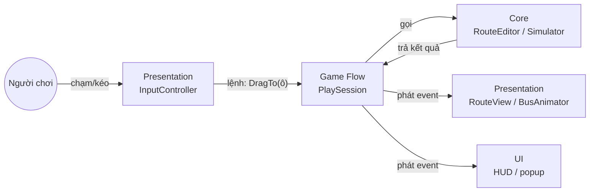
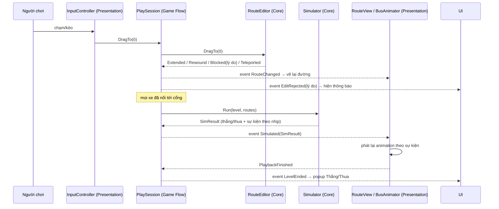

# Bus Loop — Kiến trúc hệ thống Unity (BẢN NHÁP ĐỂ BÀN)

> Trạng thái: **đã chốt UI/tween/service/project (§10), còn 3 điểm mở (§11); chưa code.**
> Nguồn luật chơi: bản web `bus_loop_3d.html` + `DEVLOG.md` (50 màn, 4 cơ chế).

## 1. Mục tiêu thiết kế

| Mục tiêu | Nghĩa cụ thể trong dự án này |
|---|---|
| **Ổn định** | Luật chơi chạy được và kiểm thử được **không cần mở scene**. Mọi màn được kiểm tra tự động "có lời giải" trước khi vào game. Hình ảnh lỗi không làm sai luật. |
| **Tái sử dụng** | Lõi luật chơi là thư viện C# thuần, đóng gói thành **package** dùng lại cho project khác / bản server / công cụ sinh màn. Prefab, config, service dùng chung giữa các màn. |
| **Phát triển tương lai** | Thêm cơ chế mới = thêm 1 class luật + 1 prefab hiển thị + đăng ký, **không sửa code cũ**. Thêm màn = thêm 1 file dữ liệu. Đổi giao diện không đụng luật. |

## 2. Kiến trúc tổng thể — các khối, phụ thuộc một chiều

| Khối | Một câu mô tả |
|---|---|
| **UI** | Nút, bảng, popup 2D (Home, chọn màn, HUD, thắng/thua). |
| **Presentation** | Thế giới 3D của màn chơi: dựng bàn, vẽ đường, xe chạy, người nhảy, hiệu ứng, bắt cú kéo tay. |
| **Game Flow** | Người điều phối: nhận mọi lệnh, hỏi Core, gọi Data, phát event. |
| **Data** | **Tải & lưu dữ liệu**: lấy file màn (`LevelRepository`), đọc/ghi save (`SaveService`). Khối **duy nhất** đụng tới file/mạng. |
| **Services** | Tiện ích dùng chung: xu, tiến độ, âm thanh, rung (sau: quảng cáo, mua hàng, analytics). |
| **Config** | ScriptableObject: màu, tốc độ, prefab, danh sách màn — designer chỉnh trong Inspector. |
| **Serialization** | Bộ dịch dùng chung: đổi JSON ⇄ dữ liệu màn / save của Core (game, bộ sinh màn, test đều dùng). |
| **Core** | Luật chơi C# thuần: biết "màn chơi là gì", kiểm tra đường vẽ, mô phỏng thắng/thua. **Không biết JSON, không mở file.** |

Có **2 câu hỏi khác nhau**, nên có 2 sơ đồ:

### 2a. Phụ thuộc — "khi viết code, ai cần biết đến ai?"
Mũi tên `A --> B` = **A biết B** (A dùng kiểu dữ liệu/hàm của B). **Không phải** thứ tự chạy.



- Presentation phải "hiểu ngôn ngữ" của Core (ô lưới, xe, sự kiện `Pick/Drop/Teleport`…) để vẽ ra được → nó **biết** Core.
- Core **không biết** Presentation, UI hay Unity tồn tại → test bằng NUnit trong vài mili-giây, dùng lại ở bất cứ đâu.
- Mỗi tầng là 1 **Assembly Definition** riêng → nếu ai viết ngược chiều (Core gọi Presentation), Unity báo lỗi compile ngay.

### 2b. Luồng chạy — "khi chơi, việc gì xảy ra trước?"

**① Tải màn** (khi người chơi chọn màn):


**② Chơi** — **Core tính xong trước, Presentation hiển thị sau**, dữ liệu chảy *từ* Core *ra* Presentation:



Core **không gọi** Presentation: nó chỉ *trả kết quả* cho người gọi (Game Flow). Game Flow *phát event* ("đường vừa đổi", "đã mô phỏng xong"), Presentation/UI *đăng ký nghe* và tự vẽ — giống trọng tài thổi còi, còn đài truyền hình tự quay; trọng tài không cần biết có đài nào.

### 2c. Ba quy tắc giữ hệ thống sạch
1. **Core không biết ai ở trên nó** — chỉ nhận dữ liệu vào, trả kết quả ra.
2. **Presentation chỉ ĐỌC Core**, không ra lệnh cho Core. Mọi thao tác làm thay đổi trạng thái (vẽ đường, chạy xe, lùi bước) đều **đi qua Game Flow** → chỉ có 1 "cửa" duy nhất, dễ kiểm soát, dễ ghi log, dễ làm Undo/Replay.
3. **Presentation chỉ phát lại** kết quả Core đã tính (§5) → animation giật/lag/tua nhanh cũng không làm sai kết quả màn.

## 3. Các module

### 3.1 Core (package `com.busloop.core`, `noEngineReferences: true`)
| Thành phần | Trách nhiệm |
|---|---|
| `LevelData` | Khuôn dữ liệu của 1 màn (bàn, xe, `features`) — C# thuần, **không biết được lưu bằng định dạng gì**. |
| `Level` | Màn đã "biên dịch": lưới ô, chỉ mục cơ chế, danh sách xe. |
| `RouteEditor` | Toàn bộ logic **vẽ đường**: chọn xe, kéo, lùi, chặn, cắt đường, dịch chuyển. Trả về kết quả có mã lỗi (`Blocked: Solid / OverlapsRoute / MustGoStraight …`) để UI tự chọn câu thông báo. |
| `Simulator` | Chạy cả màn **theo nhịp (tick)**, mọi xe cùng tiến 1 ô/nhịp; trả về `SimResult` = thắng/thua + **danh sách sự kiện** (đến ô, trả khách, đón khách, dịch chuyển, về cổng, kẹt). |
| `IMechanic` + các cơ chế | Mỗi cơ chế là 1 class: `Pickup`, `Station` (thường/màu), `Block`, `Overpass`, `Teleport`. |
| `LevelValidator` | Kiểm tra cấu trúc màn + **chạy lời giải mẫu** qua `RouteEditor` và `Simulator`. |

### 3.1b Serialization (package `com.busloop.serialization`, `noEngineReferences: true`, chỉ phụ thuộc Core)
| Thành phần | Trách nhiệm |
|---|---|
| `LevelJson` | Đọc/ghi JSON ⇄ `LevelData`; đọc trường `schema` và **nâng cấp file màn cũ** lên định dạng mới. |
| `SaveJson` | Đọc/ghi file save ⇄ dữ liệu người chơi, có `version` + hàm nâng cấp `v1 → v2…`. |

Dùng chung cho: `LevelRepository` / `SaveService` (game) · bộ sinh màn · Editor tool Validate · test. Đổi định dạng lưu (JSON → nhị phân, hoặc định dạng server) = sửa/thêm ở đây, **Core không đổi**.

### 3.2 Config (ScriptableObject — designer chỉnh trong Inspector)
| Asset | Nội dung |
|---|---|
| `GameConfig` | Tốc độ xe, thời gian nhảy, người/nhóm (=3), xu thưởng, xu khởi đầu. |
| `PaletteConfig` | Mã màu (`red`, `blue`…) → màu thật, màu viền. Đổi màu toàn game ở 1 chỗ. |
| `LevelCatalog` | Danh sách màn theo thứ tự; nút **Validate All** chạy kiểm tra cả 50 màn. |
| `MechanicViewCatalog` | Loại cơ chế (`"pickup"`, `"overpass"`…) → prefab hiển thị. |
| `BusSkinCatalog` | Sức chứa (3/6/9 chỗ) → prefab xe; sau này thêm skin. |
| `AudioCatalog` | Tên sự kiện → clip âm thanh. |

### 3.3 Game Flow
- `GameStateMachine`: `Boot → Home → LevelSelect → Playing(Drawing ⇄ Running) → Result`.
- `PlaySession`: bọc `Level + RouteEditor + Simulator` cho màn đang chơi; phát event C# (`RouteChanged`, `EditRejected`, `Simulated`) cho View/UI nghe.
- Composition root `GameBootstrap` (1 MonoBehaviour trong scene Boot) tạo service + config.

### 3.4 Services (interface + 1 cài đặt mặc định, thay được)
**Data** (§3.7): `ILevelRepository` (lấy dữ liệu màn) · `ISaveService` (JSON trong `persistentDataPath`, có version).
**Services**: `IEconomyService` (xu, tim) · `IProgressService` (màn đã qua) · `IAudioService` · `IHapticsService` · sau này: `IAdsService`, `IIapService`, `IAnalyticsService`.

### 3.7 Dữ liệu & tải dữ liệu

**Quy tắc vàng:** chỉ tầng **Services** được đọc/ghi file hoặc gọi mạng. Core, Presentation, UI **không bao giờ** tự mở file.

| Loại dữ liệu | Nằm ở đâu | Ai tải | Khi nào |
|---|---|---|---|
| Màn chơi | `Assets/BusLoop/Levels/level_###.json` (danh sách trong `LevelCatalog`) | `ILevelRepository` | Khi người chơi chọn màn |
| Config | ScriptableObject (`GameConfig`, `PaletteConfig`, các Catalog) | `GameBootstrap` (gắn sẵn trong Inspector) | Lúc mở game |
| Dữ liệu người chơi (tiến độ, xu, cài đặt) | File save trong `persistentDataPath` | `ISaveService` | Đọc lúc mở game; ghi khi thắng / đổi cài đặt / mua |
| Hình, âm thanh, prefab | `Art/`, `Audio/`, `Prefabs/` | Do Config trỏ tới (giai đoạn sau có thể chuyển sang Addressables) | Khi Presentation cần vẽ/phát |

**Chia việc: Data biết *file ở đâu*, Serialization biết *định dạng file*, Core biết *màn chơi là gì*:** `ILevelRepository` lấy chuỗi JSON (từ project, sau này từ mạng hay ổ đĩa khi test) → đưa cho `LevelJson.Parse` (**Serialization**) → `LevelValidator` (**Core**) kiểm tra → trả về màn đã sẵn sàng. Đổi nguồn dữ liệu = viết `ILevelRepository` mới, Core không đổi.

**Thứ tự khởi động (scene Boot):**
```
GameBootstrap
 1. gắn Config (GameConfig, PaletteConfig, LevelCatalog, các Catalog)
 2. ISaveService.Load()   → tiến độ, xu, cài đặt (nâng cấp save cũ nếu khác version)
 3. tạo & đăng ký service: LevelRepository, Progress, Economy, Audio, Haptics
 4. GameStateMachine → Home
```

**Khi chọn màn N:**
```
UI → GameFlow.PlayLevel(N)
 → ILevelRepository.Load(N): đọc level_N.json → LevelJson.Parse (Serialization) → LevelValidator (Core)
     (lỗi → báo lỗi + quay về chọn màn, không crash)
 → tạo PlaySession(level)
 → event LevelLoaded → Presentation dựng bàn chơi · UI hiện "Màn N" + gợi ý
```

**Khi thắng:** GameFlow → `IProgressService.Complete(N)` + `IEconomyService.Add(30)` → `ISaveService.Save()`.

**Save có version:** `{ "version": 1, "progress": {...}, "coins": 340, "settings": {...} }` — đổi cấu trúc ở bản sau thì viết hàm nâng cấp `v1 → v2`, người chơi cũ không mất tiến độ.

### 3.5 Presentation
`BoardView` dựng bàn từ `Level` + `MechanicViewCatalog` · `RouteView` (mesh đường bo cua) · `BusView` + `BusAnimator` (phát lại sự kiện, nghiêng khi cua) · `PassengerPool` (object pool người chibi) · `FxService` · `InputController` (chạm → ô → `RouteEditor`).

### 3.6 UI
Màn Home, Chọn màn, HUD, Cài đặt, Cửa hàng, Thắng/Thua. UI **chỉ** gọi `GameStateMachine`/`PlaySession` và nghe event — không chứa luật.

## 4. Dữ liệu màn chơi

Mỗi màn 1 file JSON (`Assets/BusLoop/Levels/level_001.json`) — dễ đọc, dễ diff trên Git, bộ sinh màn hiện tại xuất thẳng ra được, 50 màn web chuyển sang tự động.

```json
{
  "schema": 1,
  "id": "level_025",
  "tip": "Cầu vượt: 1 xe chạy trên cầu, 1 xe chui dưới",
  "size": 7,
  "buses": [
    { "id": "A", "color": "red", "capacity": 2, "start": [0,1], "end": [6,1],
      "solution": [[0,1],[1,1],[2,1]] }
  ],
  "features": [
    { "type": "pickup",   "at": [3,0], "color": "red", "groups": 2 },
    { "type": "station",  "at": [5,0] },
    { "type": "station",  "at": [4,3], "color": "blue" },
    { "type": "block",    "at": [2,2] },
    { "type": "overpass", "at": [3,3] },
    { "type": "teleport", "at": [1,4], "to": [6,5] }
  ]
}
```
- `features` là danh sách **chung có `type`** → cơ chế mới chỉ cần thêm `type` mới, không đổi cấu trúc file.
- `solution` là lời giải mẫu: dùng cho nút Gợi ý, Xem mẫu và kiểm thử tự động.

## 5. Luồng một lượt chơi


Kết quả thắng/thua **đã biết trước khi xe lăn bánh** → animation chỉ để xem, không thể làm lệch luật; tua nhanh ×2 hay bỏ qua animation đều an toàn.

## 6. Thêm cơ chế mới (ví dụ: "đèn giao thông")

1. Core: tạo `TrafficLightMechanic : IMechanic` (+ `IRouteRule` / `IArrivalEffect` nếu cần), đăng ký vào `MechanicSet.Default`.
2. Dữ liệu: dùng `{"type":"trafficLight", ...}` trong `features`.
3. Hiển thị: tạo prefab có component `IFeatureView`, thêm vào `MechanicViewCatalog`.
4. Test: thêm 1 màn mẫu + unit test. **Không sửa** RouteEditor, Simulator, UI.

## 7. Kiểm thử & an toàn

- **EditMode tests (Core)**: cả 50 màn — lời giải vẽ được bằng `RouteEditor` và thắng bằng `Simulator`; test riêng từng cơ chế; test lỗi (đường trùng, đi xuyên vật cản…).
- **Validate trong Editor**: menu `BusLoop ▸ Validate All Levels`, chặn build nếu có màn hỏng.
- **PlayMode smoke test**: mở màn 1, chạy lời giải, phải tới màn Thắng.
- Lưu game có `version` → đổi cấu trúc sau này vẫn đọc được save cũ.

## 8. Cấu trúc thư mục

```
My project/                    (Unity 2022.3 — C:/Users/DELL/Downloads/BusLoop3D(XGame))
├─ Packages/com.busloop.core/           Core — luật chơi, tái sử dụng được
│  ├─ Runtime/   Model · Mechanics · Routing · Simulation · Validation
├─ Packages/com.busloop.serialization/  JSON ⇄ dữ liệu màn / save (dùng chung)
│  ├─ Runtime/   LevelJson · SaveJson · Migrations
│  └─ Tests/Editor/
└─ Assets/BusLoop/
   ├─ Scripts/  Flow · Services · Presentation · UI · Editor   (mỗi thư mục 1 asmdef)
   ├─ Config/   GameConfig, PaletteConfig, LevelCatalog …     (ScriptableObject)
   ├─ Levels/   level_001.json … level_050.json
   ├─ Prefabs/  Bus_3, Bus_6, Bus_9, Passenger, Pickup, Station, Overpass, Teleport …
   ├─ Art/ · Audio/ · UI/
   └─ Scenes/   Boot, Game
```

## 9. Lộ trình

| Giai đoạn | Nội dung | Xong khi |
|---|---|---|
| 1. Lõi | Core + chuyển 50 màn + test | 50/50 màn pass test, chưa có hình |
| 2. Chơi được | Bàn chơi, vẽ đường, xe chạy theo sự kiện (hình khối tạm) | Chơi hết 1 màn trong Editor |
| 3. Đồ hoạ | Toon shader, xe/người chibi, hiệu ứng, âm thanh | Giống bản web |
| 4. Khung game | Home, chọn màn, cài đặt, lưu tiến độ, thắng/thua | Vòng chơi đầy đủ |
| 5. Vận hành | Shop, quảng cáo, analytics, build Android/iOS | Lên store |

## 10. Quyết định đã chốt ✅ (2026-11-05)

| Hạng mục | Quyết định |
|---|---|
| Project | `C:\Users\DELL\Downloads\BusLoop3D(XGame)\My project` (bạn tạo sẵn, đang trống) |
| Phiên bản Unity | **2022.3.62f3 LTS** (theo project có sẵn) → code giới hạn **C# 9** |
| UI | **uGUI** + TextMeshPro (đã có trong project) |
| Tween | **DOTween** (bản miễn phí, import từ Asset Store) — chỉ tầng Presentation/UI dùng, Core không phụ thuộc |
| Kết nối service | **Service locator** đơn giản; mọi service qua interface để sau đổi sang DI được |
| Render pipeline | **URP 14.0.11** — ✅ đã cài & gán vào Graphics + 6/6 Quality (2026-11-05), 0 lỗi compile. Asset: `Assets/BusLoop/Settings/Rendering/BusLoop_URP.asset` (HDR tắt, MSAA 4x), tạo bằng menu `BusLoop ▸ Setup ▸ Configure URP` |

## 11. Điểm còn mở ❓

1. **Quản lý phiên bản**: project chưa có git. Đề xuất tạo repo riêng (`.gitignore` chuẩn Unity, Git LFS cho ảnh/âm thanh).
2. **Bộ sinh màn**: giai đoạn 1 giữ công cụ Node.js hiện có (xuất thẳng JSON đúng định dạng §4); làm Editor window sinh màn trong Unity ở giai đoạn sau.
3. **MCP for Unity**: cài package bridge vào project để Claude điều khiển/kiểm tra Unity Editor trực tiếp (đọc console, chạy test, dựng scene) — không bắt buộc nhưng giúp làm nhanh và chắc hơn.
